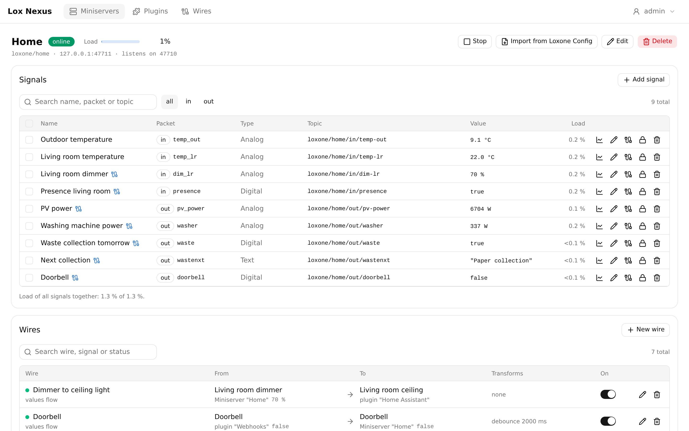
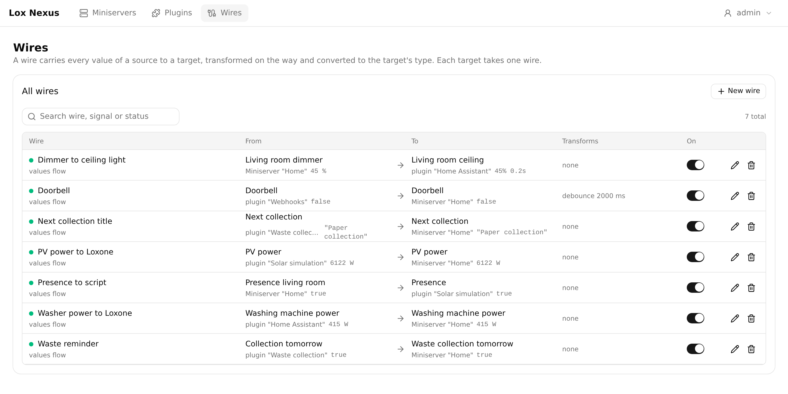
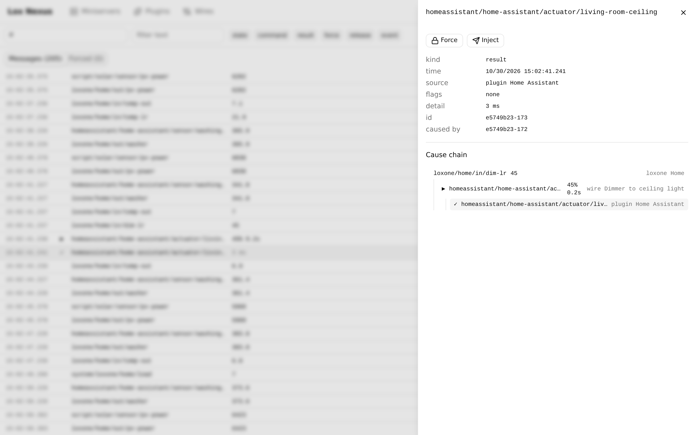
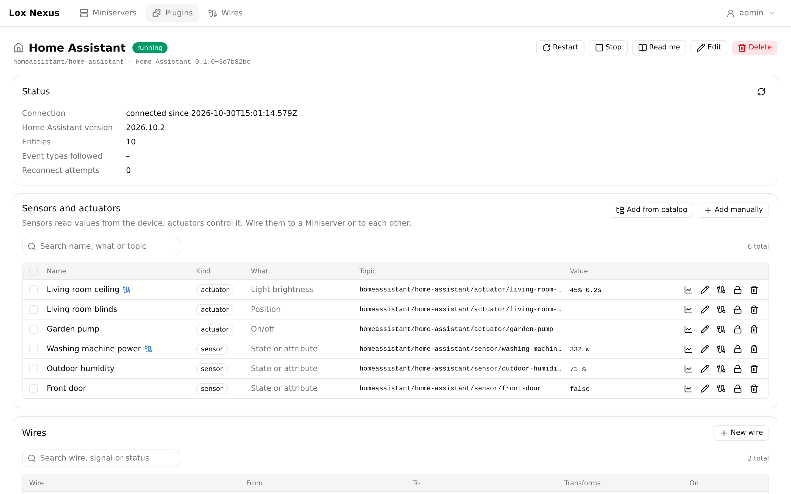
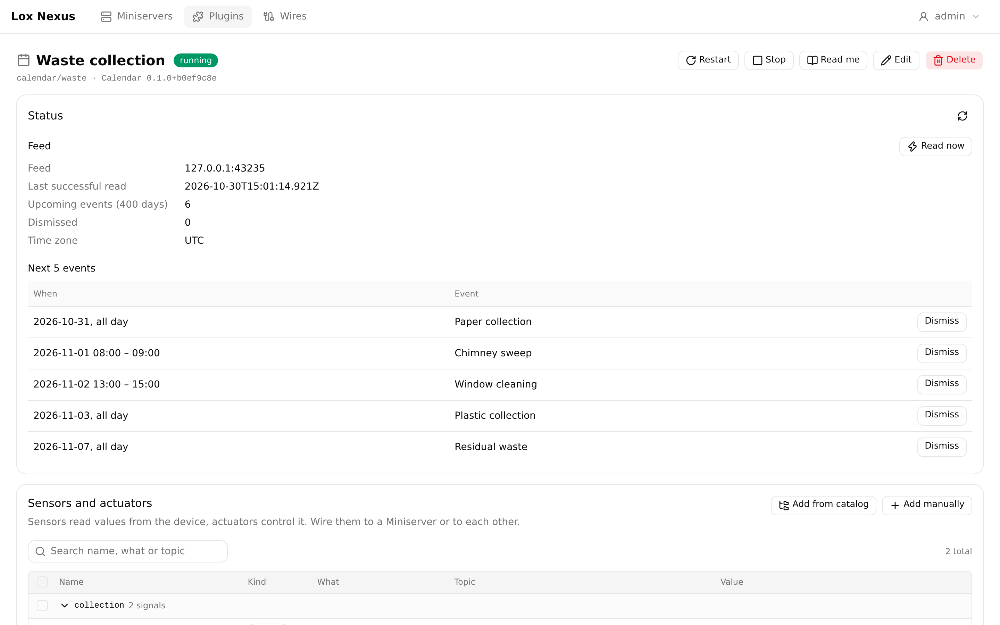

# Lox Nexus

[](https://github.com/Multivit4min/lox-nexus/actions/workflows/ci.yml)
[](https://github.com/Multivit4min/lox-nexus/pkgs/container/lox-nexus)
[](https://multivit4min.github.io/lox-nexus/)
[](LICENSE)

Lox Nexus connects other systems to your **Loxone Miniserver**. Home Assistant, a Fronius
inverter, an iCal calendar, an MQTT broker or anything else you write a plugin for becomes a set
of values the Miniserver reads and writes. It uses Loxone's own **Network Intercommunication**
(UDP), so the Miniserver needs no extra hardware, no cloud and no HTTP polling.

Nexus is a self-hosted server with a web UI. It runs in Docker (amd64 and arm64, e.g. a
Raspberry Pi 4 or 5) or straight from a checkout with Node.js.

<p align="center">
  <a href="docs/screenshots/miniserver.png"></a>
</p>

> **Status:** under active development. The Docker image is published for amd64 and arm64; the
> plugin SDK isn't on npm yet, so plugins are developed in a checkout of this repository.
> Lox Nexus is a rewrite of the earlier Nexus, which stays available on the
> [`legacy` branch](https://github.com/Multivit4min/lox-nexus/tree/legacy). It doesn't read the
> old configuration.

## Features

- **Loxone intercommunication, built in.** Nexus is one more peer next to your Miniservers. It
  has its own implementation of the protocol, with a lab tool for decoding payloads such as T5
  and RGBW smart actuator values.
- **Signals and wires.** Every value is a signal: a Miniserver input or output, a plugin's sensor,
  a command to a device. A wire links a source to a target and can invert, scale, map, debounce,
  throttle or convert the value on the way. Signals can carry a unit and a precision, and warn
  you when a value stops arriving.
- **Plugins in isolation.** Each plugin instance runs in its own worker thread, so one that
  crashes or hangs doesn't affect the rest; a crashed one restarts by itself. Plugins are
  installed, updated and rolled back in the web UI from the built-in repository, a ZIP file or a
  git repository, without restarting Nexus. Settings are checked before they are saved, and many
  plugins offer **Test connection**.
- **See and override everything.** The Bus Inspector shows every message live with its cause
  ("Loxone dimmer → wire → Home Assistant light, 59 ms"). A **force** pins any signal to a value
  for testing or maintenance, and test values can be injected.
- **History.** Charts of the signals you choose, kept as long as you set. For long-term storage,
  the InfluxDB plugin writes to InfluxDB (e.g. for Grafana).
- **Backup and moving.** The Backup page saves the whole installation as one file. The config
  export carries Miniservers, signals, wires and plugin instances, with their secrets sealed by a
  passphrase if you include them.
- **Diagnostics.** Memory, CPU, event loop, each plugin's worker, bus and Miniserver traffic, and
  disk use, on one page.

## Screenshots

<table>
  <tr>
    <td width="50%" valign="top">
      <a href="docs/screenshots/wires.png"></a>
      <br><b>Wires</b> connect any source to any target, showing the value they carry.
    </td>
    <td width="50%" valign="top">
      <a href="docs/screenshots/bus-inspector.png"></a>
      <br><b>Bus Inspector</b>: a Loxone dimmer, the wire, and Home Assistant confirming in 3 ms.
    </td>
  </tr>
  <tr>
    <td width="50%" valign="top">
      <a href="docs/screenshots/plugin-homeassistant.png"></a>
      <br><b>A plugin instance</b>: status, sensors and actuators with live values.
    </td>
    <td width="50%" valign="top">
      <a href="docs/screenshots/plugin-calendar.png"></a>
      <br><b>Plugin panels</b>: the calendar's feed status and next events.
    </td>
  </tr>
</table>

Click a screenshot for the full size. They show a demo installation with made-up data.

## Plugins

These ship with Nexus and can be installed from the **Plugins** page right away:

| Plugin | What it does |
|---|---|
| [Home Assistant](plugins/homeassistant) | Entity states, attributes and events as sensors. Switches, lights (brightness, RGBW, colour temperature), covers, locks, thermostats, scenes, scripts and any service call as actuators. |
| [Fronius](plugins/fronius) | PV, grid, load and battery power, energy counters, smart meter, battery and Ohm Pilot values from a Fronius inverter, polled every few seconds. |
| [Calendar](plugins/calendar) | Reads an iCal feed: whether a matching event is active, its title, and when it starts or ends. Events can be dismissed from Loxone or the panel. |
| [MQTT](plugins/mqtt) | Reads and publishes topics, and exports chosen signals to the broker with Home Assistant discovery. |
| [Webhook](plugins/webhook) | Lets other systems push to Loxone over HTTP: a pulse per call, or a value from the body, query or form, with a token. |
| [Script](plugins/script) | A small JavaScript program as a plugin, for logic that doesn't fit a wire. |
| [InfluxDB](plugins/influxdb) | Writes the values of chosen signals to InfluxDB 1, 2 or 3, with batching and retries. |
| [Matter bridge](plugins/matter-bridge) | Shows Nexus devices to Apple Home, Google Home, Alexa and Home Assistant, e.g. for voice control. |

You can [write your own](#writing-plugins). Plugins depend only on the SDK and talk to Nexus
through messages.

## Quick start

With Docker on Linux:

```sh
mkdir lox-nexus && cd lox-nexus
curl -fsSLO https://raw.githubusercontent.com/Multivit4min/lox-nexus/main/compose.yaml
docker compose up -d
```

The image is `ghcr.io/multivit4min/lox-nexus`: `latest` is the newest release, `edge` follows
the `main` branch.

Open `http://<host>:8080/`. The first visit asks you to create the admin account. Then:

1. Add your Miniserver and set up intercommunication on both sides, see
   [Setting up a Miniserver](apps/docs/content/guide/loxone.md).
2. Install a plugin on the **Plugins** page and add an instance of it.
3. Connect signals with wires.

The compose file uses **host networking**: each Miniserver sends its UDP packets to a port of the
host (61263 by default), and Nexus sees the Miniservers' real addresses. With a bridged network,
publish the web port and every intercommunication port yourself. All data lives in the `/data`
volume.

To update, run `docker compose pull && docker compose up -d`. The database is migrated at startup,
and the **Plugins** page then offers the new versions of the first-party plugins with **Update
all**.

Building the image yourself, running from source and running behind a reverse proxy are covered
in the [installation guide](apps/docs/content/guide/installation.md).

## Configuration

Settings come from environment variables (`environment:` in `compose.yaml`):

| Variable | Default | Meaning |
|---|---|---|
| `NEXUS_DATA_DIR` | `./data` (`/data` in the image) | Database, history and installed plugins |
| `NEXUS_HTTP_HOST` / `NEXUS_HTTP_PORT` | `0.0.0.0` / `8080` | Where the web UI and API listen |
| `NEXUS_LOG_LEVEL` | `info` | Server log level |
| `NEXUS_SECURE_COOKIES` | `false` | Set to `true` behind HTTPS |
| `NEXUS_TRUST_PROXY` | | Reverse proxy addresses whose `X-Forwarded-For` is trusted |
| `NEXUS_PUBLIC_ORIGINS` | | The address the UI is reached at, when a proxy rewrites the `Host` header |
| `NEXUS_WEB_DIR` | set in the image | The built web UI to serve |
| `NEXUS_DOCS_DIR` | set in the image | The built documentation, served at `/docs/` without a login |
| `NEXUS_PLUGIN_REPOSITORY` | `<data dir>/plugin-repository` | A folder with one built plugin per subfolder, offered for installing |
| `NEXUS_DEV_PLUGINS_DIR` | | Development: run every plugin in this folder from source |

Forgot your password? `npm run reset-password` sets a new one, in Docker with
`docker compose exec nexus npm run reset-password`.

## Documentation

The full documentation is online at **https://multivit4min.github.io/lox-nexus/**, and built into
the server at `http://<host>:8080/docs/`. Its sources are in [`apps/docs/content`](apps/docs/content):

- [Installation](apps/docs/content/guide/installation.md), [Concepts](apps/docs/content/guide/concepts.md),
  [Setting up a Miniserver](apps/docs/content/guide/loxone.md), [Wires](apps/docs/content/guide/wires.md)
- [History](apps/docs/content/guide/history.md), [Backup](apps/docs/content/guide/backup.md),
  [Diagnostics](apps/docs/content/guide/diagnostics.md)
- Each plugin's page under [`plugins`](apps/docs/content/plugins)
- What changed in each release: [CHANGELOG.md](CHANGELOG.md)

## Writing plugins

A plugin is a TypeScript package that depends only on `@lox-nexus/plugin-sdk`. It declares
sensors (values from the device), actuators (commands to it), and optionally a catalog of
ready-made signals, a status panel and buttons. The [quick start](apps/docs/content/plugins/index.md)
builds a working plugin in about ten minutes; the [plugin guide](apps/docs/content/plugins/authoring.md)
and [SDK at a glance](apps/docs/content/plugins/sdk-at-a-glance.md) cover the rest. The Fronius
plugin is a small complete example, the Home Assistant plugin one with a persistent connection.

## Development

Requires Node.js 24 or newer.

```sh
npm install
npm run lint && npm run typecheck && npm test
npm run dev            # server in watch mode on http://localhost:8080, with the UI and docs;
                       # runs plugins/* from source and restarts a plugin when its files change
npm run dev:web        # rebuilds the UI on every save; reload the page to see changes
npm run dev:web:hmr    # alternative: Vite with hot reload on http://127.0.0.1:5173
npm run build          # web UI, documentation and plugin bundles
```

`npm run dev` reads a `.env` file at the repository root if there is one. Behind a path-prefix
proxy (such as code-server), use `dev` with `dev:web` and open `…/proxy/8080/`; set
`NEXUS_PUBLIC_ORIGINS` if the proxy rewrites the `Host` header.

| Path | Contents |
|---|---|
| `packages/ici` | The Loxone intercommunication protocol, standalone, with the `ici-lab` tool |
| `packages/plugin-sdk` | The public plugin SDK |
| `packages/core` | Event bus, forces, wires, plugin supervisor (no IO) |
| `packages/loxone` | Miniserver integration |
| `packages/api` | REST and WebSocket contract between server and UI |
| `apps/server` | Server: HTTP API, persistence, authentication, plugin installer |
| `apps/web` | Web UI (Vue 3, Tailwind, shadcn-vue) |
| `apps/docs` | Documentation site |
| `plugins/*` | First-party plugins |
| `docs/` | Architecture, decision records, roadmap |

Read [`docs/architecture.md`](docs/architecture.md) before larger changes. The conventions
(class per file, short files, lifetimes through `Disposable`, package boundaries) are in
[`CLAUDE.md`](CLAUDE.md) and enforced by ESLint.

## AI disclosure

Lox Nexus is written largely by Claude (Anthropic) through Claude Code, under the maintainer's
direction. Commits written this way carry a `Co-Authored-By: Claude` line. The maintainer makes the
design decisions, recorded in [`docs/adr`](docs/adr), and tests Nexus against a real Miniserver,
Fronius inverters and Home Assistant. Every change passes lint, type checks and over 1,200
automated tests in CI; code and security reviews are AI-assisted too.

It is early software: read before you rely on it for things that matter in your home, and report
what you find ([issues](https://github.com/Multivit4min/lox-nexus/issues), or privately as
described in [`SECURITY.md`](SECURITY.md)).

## License

Lox Nexus is free software under the **GNU General Public License v3.0 or later**
([`LICENSE`](LICENSE)): the server, the web UI and the packages they are built from (`apps/*`,
`packages/core`, `packages/loxone`, `packages/api`).

The parts other projects build on are under the **MIT License**, each with its own `LICENSE` file:
the plugin SDK (`packages/plugin-sdk`), the protocol library (`packages/ici`) and the first-party
plugins (`plugins/*`). Plugins depend only on the SDK and talk to Nexus through messages, so a
plugin may use any license, closed source included. See
[ADR 0015](docs/adr/0015-licensing.md).

Lox Nexus is not affiliated with or endorsed by Loxone Electronics GmbH. Loxone and Miniserver are
trademarks of their owners.
